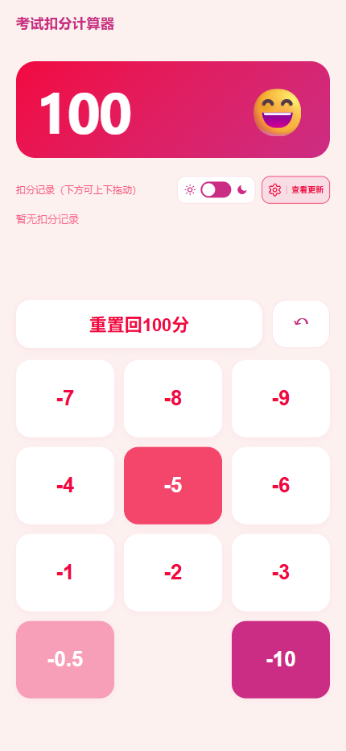
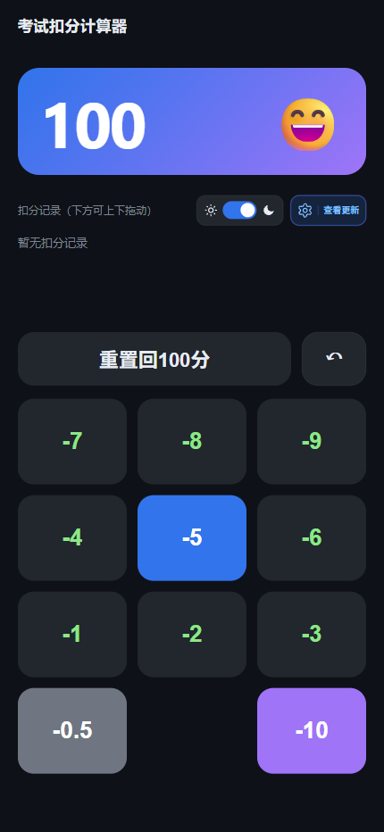
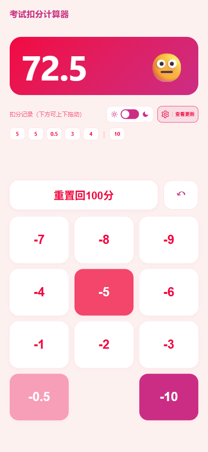
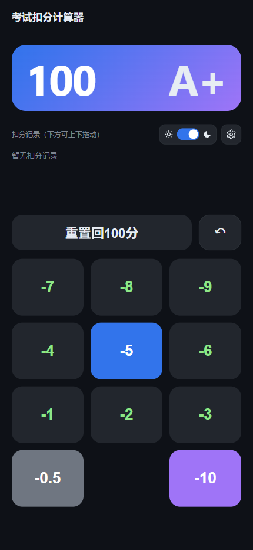
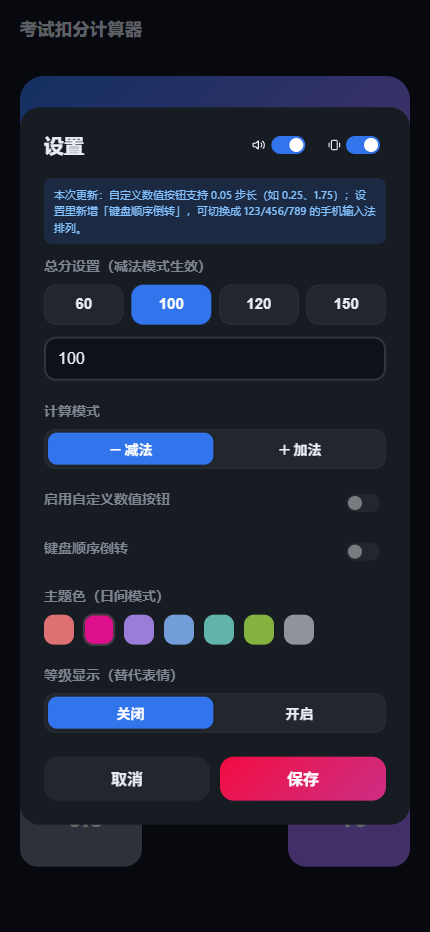
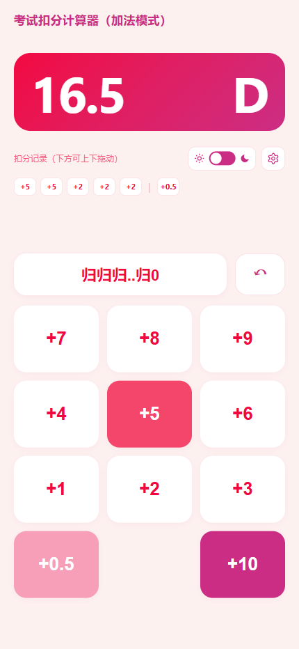

# 🧮 考试扣分计算器 / Exam Deduction Calculator

**从满分往下扣的改卷神器 —— 为「改卷时只知道扣了多少分」的老师设计。**

[](#-功能特性)
[](LICENSE)
[](#-技术实现)
[](#-技术实现)

传统成绩计算器是加法式的：从 0 开始往上加。但老师改卷时的真实思考过程是反过来的 —— **总分已知，看到错题就往下扣**。这个工具就是照着改卷的实际节奏做的。

## ✨ 功能特性

### 🎯 核心体验
- **减法模式**：从满分（默认 100）往下扣，改完卷剩余分数就是成绩，改卷节奏不断手
- **加法模式**：也可切换成传统从 0 往上加的算法（适用于计算累计得分等场景）
- **一键归位**：`重置回100分` / `归归归..归0`，下一份卷子秒切
- **撤销**：手滑扣错了一键 ↶ 撤回
- **扣分记录**：底部完整展示这一份卷子每笔扣分，方便复查

### ⚙️ 个性化设置
- **自定义数值键**：键盘上可以多出一个自定义扣分键（0.05～9.9，支持 0.05 步长，如 0.25、1.75）
- **键盘顺序倒转**：789/456/123 ↔ 123/456/789，切换成手机输入法的排列习惯
- **等级显示**：可关闭表情，改成 A+ / A / B / C / D 等级显示，等级名称与分界线全部可自定义（如：A+ ≥95，A ≥85，B ≥75，C ≥60，D 为其余）
- **7 种主题色**：红 / 粉 / 紫 / 蓝 / 青 / 绿 / 灰，全部低饱和配色
- **夜间模式**：GitHub Dark 配色，晚上改卷不刺眼
- **音效与震动**：每次按键可选播放咔哒声、触发轻微震动（移动端）

### 🎁 小彩蛋
分数被扣成**负分**的时候，标题会变成 —— 「这孩子是犯天条了吗？」（闪烁动画，回正分自动恢复）

## 📱 界面预览

| 日间模式（粉红主题） | 夜间模式（GitHub Dark） |
|:---:|:---:|
|  |  |

| 扣分后（记录自动累计） | 等级显示（自定义分界线） |
|:---:|:---:|
|  |  |

| 设置面板 | 加法模式 |
|:---:|:---:|
|  |  |

> 更多截图见 [screenshots/](screenshots/) 目录，共 12 张，覆盖全部主要界面。

## 🚀 快速开始

### 方式一：直接打开（最简单）

1. 下载本仓库（`git clone` 或 Code → Download ZIP）
2. **双击 `index.html`**，浏览器直接打开，完事

### 方式二：手机上用（本地）

把 `index.html` + `app.js` 两个文件传到手机同一目录，用手机浏览器打开 `index.html` 即可。

### 方式三：部署到你自己的服务器 / 静态托管

这是纯静态页面，扔到任何静态托管上都行：

```bash
# GitHub Pages
# 仓库 Settings → Pages → Source 选 master 分支即可

# 或任何静态服务器
npx serve .
```

## 🛠 技术实现

- **零依赖**：原生 HTML + CSS + JavaScript，不依赖任何框架、构建工具或包管理器
- **两个文件**：`index.html`（结构+样式）+ `app.js`（逻辑），总共 < 80KB
- **ES2017 语法**：兼容 Chrome 61+ 基线的老设备
- **本地存储**：使用 `localStorage` 持久化全部设置（总分、主题、等级方案、自定义键等），并优先尝试平台级 Storage API（适配小红书小程序容器），失败自动降级
- **移动端适配**：viewport-fit=cover、safe-area 安全区、100dvh 动态视口高度、短屏自动伸缩布局
- ** originally 为小红书「小工具」开发**：同时满足离线打包（zip 内无外链资源）、脚本外置（无 inline script）、无 eval 的容器约束，所以在标准浏览器里跑也完全没问题

## 📁 项目结构

```
.
├── index.html          # 页面结构与全部样式
├── app.js              # 全部业务逻辑
├── tests/              # 回归测试（Node 直接跑，零依赖）
├── screenshots/        # README 用的 12 张实机截图
└── README.md
```

## 🧪 测试

设置项的读写有回归测试，零依赖、不用装东西：

```bash
node tests/test-grade-persistence.js
```

它会真实加载 `app.js`，模拟「点开关 → 关页面 → 重进」，确认分数、模式、等级表、最低档都不会丢。退出码 0 表示全部通过。

## 💡 设计取舍

**为什么默认减法而不是加法？**

改卷不是从零攒分的游戏 —— 卷面总分在发卷那一刻就定了。老师在讲台上一份接一份地改，脑子里只有「这道题错，扣 X 分」，不存在「先想总分再倒推」。把交互顺着人的真实心智走，这是这个小工具唯一的野心。

**为什么只有一个页面、没有框架？**

场景是「老师改卷间隙掏出手机用一下」。加载要快、离线要能用、别让用户注册任何东西。框架和构建链在这个体量下只会拖累这三件事，所以全部手写。

**为什么表情/等级分界线可自定义？**

不同学校、不同学科的等级方案完全不一样（有的学校用 A+ / A / B，有的用「优 / 良 / 中 / 及格 / 不及格」）。硬编码一套等于替所有老师做主，索性全开放。

## 📄 License

[MIT](LICENSE)

---

## 🙌 鸣谢

- 感谢所有反馈过的老师与同学
- 本工具最初为个人自用开发，后在 [小红书](https://www.xiaohongshu.com) 以「小工具」形态发布（当前 v2.0.2）

## 🤝 贡献

欢迎 Issue 和 PR。改动请保持「零依赖、纯前端」的原则 —— 引入任何框架或构建步骤会直接违背本项目的初衷。

---

**如果这个工具帮到了你，欢迎给个 ⭐ Star —— 这是对独立开发者最实在的鼓励。**
